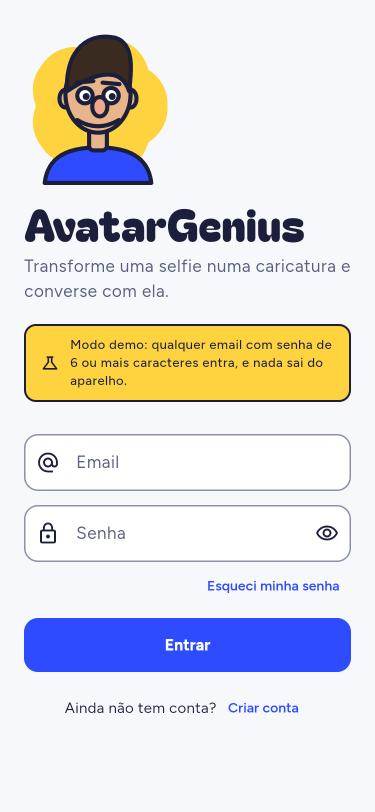
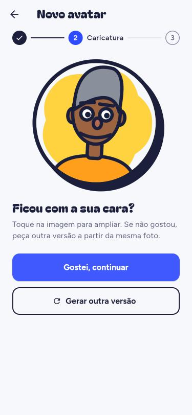
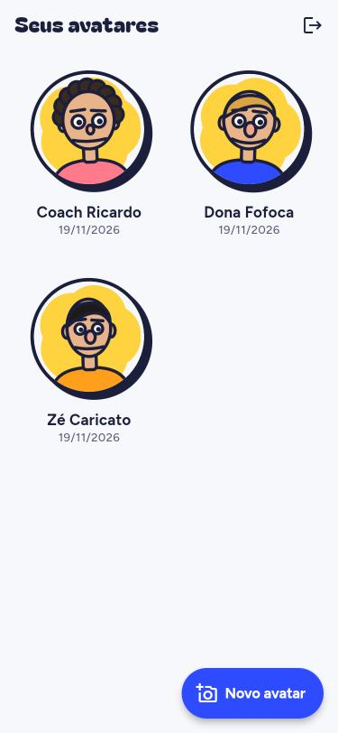
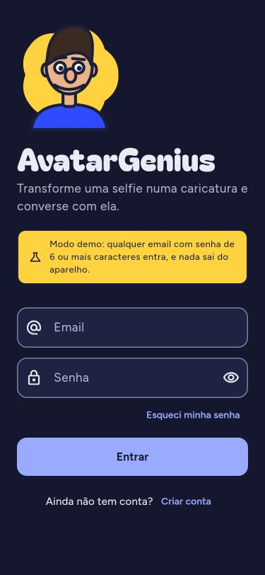
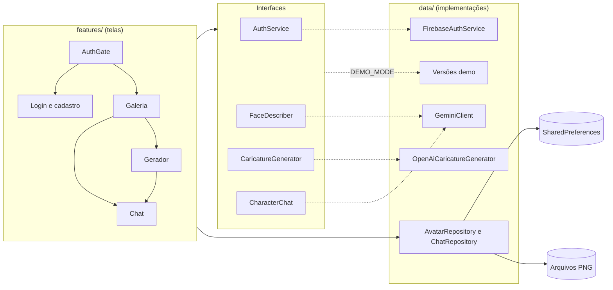

# AvatarGenius

[](https://github.com/MatheusCond/AvatarGenius/actions/workflows/ci.yml)


App Flutter que transforma uma selfie numa caricatura com IA e deixa você
conversar com ela. Você dá um nome e uma personalidade ao personagem, e ele
responde no papel.

<table>
  <tr>
    <td></td>
    <td></td>
    <td></td>
    <td></td>
    <td></td>
  </tr>
</table>

> As capturas são do **modo demo**, em que a caricatura é desenhada no próprio
> aparelho. Com as chaves de API, a imagem vem do modelo da OpenAI.

## Como funciona

1. **Foto.** Você tira uma selfie ou escolhe uma da galeria.
2. **Caricatura.** O Gemini descreve os traços do rosto em texto (formato,
   cabelo, olhos, acessórios), e essa descrição vira o prompt de um modelo de
   imagem da OpenAI, que desenha a caricatura. Se não gostar, peça outra versão
   sem reenviar a foto.
3. **Personalidade.** Você dá um nome e descreve como o personagem fala.
4. **Conversa.** O chat usa o Gemini com a personalidade como instrução de
   sistema. O histórico fica salvo por avatar.

Também tem: cadastro e login com Firebase, recuperação de senha, galeria por
usuário, salvar a caricatura nas fotos do celular, modo escuro e layout que se
adapta a celular, tablet e navegador.

## Rodar em 1 minuto (modo demo, sem chaves)

O modo demo troca o Firebase e as APIs pagas por versões locais: qualquer email
com senha de 6+ caracteres entra, a caricatura é desenhada no aparelho e o chat
responde com frases simuladas. Serve para avaliar o fluxo completo sem conta
nem custo.

```bash
flutter pub get
flutter run -d chrome --dart-define=DEMO_MODE=true
```

No navegador, use **Usar um rosto de exemplo** para testar sem câmera.

## Rodar com IA de verdade

1. Copie `env.example.json` para `env.json` (já está no `.gitignore`) e preencha:

   | Variável | Para quê | Padrão |
   |---|---|---|
   | `GEMINI_API_KEY` | Ler a foto e conduzir o chat | (obrigatória) |
   | `OPENAI_API_KEY` | Gerar a imagem da caricatura | (obrigatória) |
   | `GEMINI_MODEL` | Modelo multimodal do Gemini | `gemini-3.8-flash` |
   | `OPENAI_IMAGE_MODEL` | Modelo de imagem da OpenAI | `gpt-image-2.6-flare` |

2. Rode passando o arquivo:

   ```bash
   flutter run --dart-define-from-file=env.json
   ```

O projeto já aponta para um projeto Firebase (`lib/firebase_options.dart` e
`android/app/google-services.json`). Para usar o seu, rode
`flutterfire configure` e ative o login por email e senha no console.

No VS Code, as duas formas estão em `.vscode/launch.json`.

## Arquitetura



As telas só conhecem interfaces. `bootstrap.dart` monta a implementação certa
(Firebase e APIs reais, ou as versões demo) e a entrega à árvore de widgets por
um `InheritedWidget` (`AppScope`). Nos testes, o mesmo ponto recebe dublês.

```
lib/
├── main.dart, app.dart, bootstrap.dart   inicialização e injeção de dependências
├── config/        AppConfig: chaves e modelos via --dart-define
├── core/          tema, arte da caricatura (CustomPainter), widgets comuns
├── data/
│   ├── ai/        Gemini, OpenAI, prompts e versões demo
│   ├── auth/      Firebase Auth e login demo
│   ├── models/    Avatar, ChatMessage
│   └── storage/   repositórios e armazenamento de imagens (arquivo ou web)
└── features/      auth, gallery, generator, chat
```

### Decisões técnicas

- **Chaves fora do código.** Entram em tempo de compilação com
  `--dart-define-from-file`. Na v1, o `.env` era empacotado como asset dentro
  do APK.
- **Dados separados por usuário.** Cada conta tem a própria galeria e
  conversas. As imagens são arquivos PNG na pasta privada do app (na web, o
  `localStorage`), não strings base64 no SharedPreferences.
- **Migração da v1.** Na primeira abertura, avatares e conversas salvos pela
  versão antiga são importados para a conta logada.
- **Chat com contexto de verdade.** A personalidade vai em `systemInstruction`
  e o histórico em turnos `user`/`model`, limitado às 30 últimas mensagens para
  controlar custo e latência.
- **Erros que dizem o que fazer.** Cada falha de rede, cota, chave ou
  moderação vira uma mensagem em português com a próxima ação. Erros nunca
  entram no histórico do chat.
- **Uma única fonte de verdade para o login.** O `AuthGate` escuta o estado de
  autenticação; telas de login, cadastro e logout não navegam por conta própria.
- **Identidade visual própria.** Paleta "bloco de caricaturista" (papel, tinta
  índigo, caneta cobalto e marca-texto), Bagel Fat One nos títulos e Figtree no
  texto, com avatares em forma de adesivo. Fontes OFL embutidas em
  `assets/fonts`.

### Segurança

Num app cliente, qualquer chave embutida pode ser extraída do binário. O
`--dart-define` evita que ela vá parar no Git e nos assets, mas para produção
o caminho certo é um backend intermediário (por exemplo, Cloud Functions com
Firebase App Check) que guarde as chaves e aplique limite de uso por usuário.
Esse é o primeiro item do roadmap. As chaves do Firebase que estão no
repositório são identificadores públicos do cliente, protegidos pelas regras do
projeto, e não segredos.

## Qualidade

```bash
dart format --set-exit-if-changed lib test
flutter analyze        # lints estritos em analysis_options.yaml
flutter test           # 38 testes
```

Os testes cobrem os clientes do Gemini e da OpenAI (com `MockClient`, sem
rede), o repositório (isolamento por usuário, exclusão em cascata e migração da
v1), a autenticação e os fluxos de tela: login, galeria, exclusão e chat,
incluindo erro da IA e envio com Enter.

O GitHub Actions roda formatação, análise e testes a cada push e pull request,
e depois compila a versão web (modo demo) e o APK Android.

## Histórico

A primeira versão é de 2025. Em 2026 o projeto foi revisitado: os modelos de IA
que ele usava tinham sido desligados, então a arquitetura foi refeita, os bugs
corrigidos e a interface redesenhada. O [CHANGELOG](CHANGELOG.md) lista cada
mudança.

## Roadmap

- [ ] Backend intermediário para as chaves de API, com App Check e cota por usuário
- [ ] Sincronizar avatares e conversas entre aparelhos (Firestore e Storage)
- [ ] Build iOS
- [ ] Testes de golden para as telas principais
- [ ] Publicar a demo web no GitHub Pages

## Licença

[MIT](LICENSE). As fontes Bagel Fat One e Figtree são distribuídas sob a
[SIL Open Font License](assets/fonts/).
